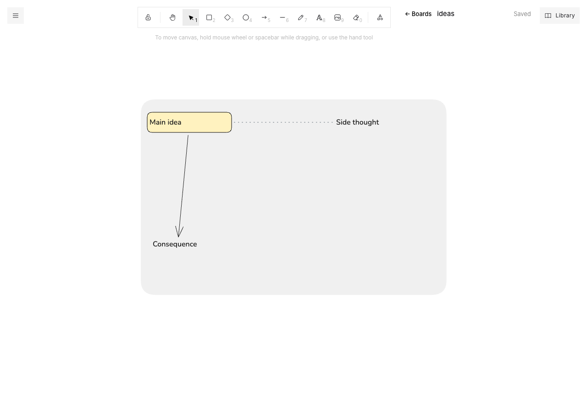

# board

Scapple-style freeform notes on top of Excalidraw. Write anywhere, then drop one note onto another to connect them.

**Live:** https://board.knhdixh.com · auto-deploys from `main` via Vercel



Scapple is a lovely way to think on paper, but it's paid and desktop-only. Excalidraw is free and runs anywhere, but it's built for diagrams. This app is Excalidraw (the MIT-licensed [`@excalidraw/excalidraw`](https://www.npmjs.com/package/@excalidraw/excalidraw) package, so it keeps getting upstream fixes) with Scapple's way of working layered on top, plus sync between devices.

## What it adds to Excalidraw

Every feature on Scapple's feature list, rebuilt on Excalidraw:

| Scapple | Here |
|---|---|
| **Write notes anywhere** | Double-click empty space to start a note, in a Helvetica-style font on cream paper. Long notes wrap at a note's width once you stop typing. **⌘-double-click** with a note selected writes a new note that's already connected to it. |
| **Connect notes using drag and drop** | Drag a note onto another: the target gets a dashed outline and a dashed line runs from your note to it ("connect this note… to this one"). Let go and they're joined with a dotted line while your note slides back. Hold ⌘ (Ctrl) for an arrow; drop again to disconnect. Drag a connecting line to move both its notes. Each gesture is one undo step. |
| **Completely freeform** | Every note is equal. Connect what you like, or nothing. **Connect** chains selected notes in reading order and **Disconnect** removes the links between them. |
| **Stack notes in columns** | **Stack** lines selected notes up in a tidy left-aligned column, **Row** lays them out side by side, and **Same width** matches their widths. Stacks are magnetic: type more into a note (or delete one) and the notes under it move down (or up). |
| **Background shapes to group notes** | **Background** puts a soft shape behind the selected notes. Drag the shape and everything on it comes along, live, as one undo step. Imported Scapple background shapes behave the same way. |
| **Customise the appearance of notes** | The note bar offers quick styles, and the **Notes panel** has them all (plain, bubble, box, dashed, five fills, title, faded). Save any note's look as your own style, and choose which style new notes get. Saved styles follow you between devices. |
| **Paper colours** | Menu → Paper: cream (the default), white, sage, sky, blueprint or night. Text, lines, fills and background shapes all change to suit, and colours you picked yourself are left alone. Any colour from Excalidraw's own canvas picker works too, with text kept readable. |
| **Notes panel** | Click the **N notes** counter (or Menu → Notes and styles) for a list of every note: find, click to jump to one, and replace text across the board. |
| **Images** | Drag images from Finder or another app onto the board, or paste them. They're stored in Supabase Storage (private, owner only), so boards stay small and quick to save. Images in older boards move to Storage the next time you open them. |
| **Command palette** | **⌘/** anywhere, like Todoist: jump to a board or a note, create or import a board, and run every board command (stack, connect, styles, paper, export, tools…). Type to filter, ↑↓ and ↵ to run. |
| **QuickZoom** | Hold **Z** to see the whole board. Let go to zoom back in where the mouse is. |
| **Move and arrange notes easily** | Excalidraw's selection, align, distribute, nudge, group and lock, plus the arrangement tools above. |
| **Full screen mode** | Menu → Full screen hides everything but your notes (Esc to leave). |
| **Export or print** | Markdown outline (connected notes nest under the note they hang from), Scapple `.scap`, PNG/SVG, `.excalidraw`, or **Print**. |
| **Drag notes into Scrivener** | **Copy text** (⌘⇧C) copies the selected notes, or the whole board, as an outline you can paste into Scrivener or anything else. Exporting a `.scap` file opens in Scapple itself. |

Also: `.scap` and `.excalidraw` import, any number of boards with autosave and sync, conflict detection between devices, search, and undo.

## Private, and doesn't expire

- **Only the owner can use it.** Supabase signups are switched off, and every row is guarded by row-level security that checks an allow-list (`allowed_users`). Anyone else who signs in sees "This board is private." and can't read or write anything.
- **The free Supabase project never pauses.** Free projects pause after 7 days without activity, so a Vercel cron (`/api/keepalive`, daily) writes a heartbeat to the database. A GitHub Actions workflow pings every three days as a backup, and using the app counts too.
- **Usage dashboard** (`/usage`) compares usage with the free-tier limits. Database size, users and storage come straight from Postgres. Supabase egress and Vercel bandwidth are measured by the app itself: the bytes of every Supabase response, and the transfer size of the site's own files.

## How it works

- **Frontend:** Vite + React, with Excalidraw's fonts self-hosted from `/fonts`. The Scapple behaviour lives in `src/scapple/` as pure functions over element arrays (`connect.js`, `layout.js`, `styles.js`, `scap.js`, `outline.js`), and `src/Editor.jsx` wires them to Excalidraw's pointer events.
- **Drop to connect:** on pointer-down the editor snapshots the scene. On pointer-up, if the pointer is over another note, it restores the snapshot and adds the connector before Excalidraw records the drag, so the whole gesture is one undo step.
- **Data:** Supabase Postgres, with one `boards` row per board holding the scene as JSON. Row-level security limits every row to its owner. A trigger bumps `version` on each write, and saves only apply `where version = <the one you loaded>`.
- **Sign-in:** Supabase email magic links, for the allow-listed owner only.
- **Hosting:** Vercel serves the static build. Every push to `main` deploys.

## Run locally

```bash
npm install
cp .env.example .env.local   # fill in your Supabase URL and publishable key
npm run dev                  # http://localhost:5173
npm test                     # unit tests (vitest)
# Browser test in headless Chrome against the real project, while `npm run dev` runs.
# It creates two throwaway users (an allow-listed owner and a stranger) and deletes them afterwards,
# and checks the whole Scapple flow: connecting, stacks, backgrounds, themes, the Notes panel, QuickZoom…
SB_SECRET=<secret key> node scripts/e2e-cloud.mjs
```

## Deploy your own

1. Create a Supabase project, then apply the schema: `supabase link --project-ref <ref> && supabase db push`.
2. In Supabase → Authentication → URL configuration, set the site URL to your domain (`supabase/config.toml` has the values, and `supabase config push` applies them).
3. Import the repo into Vercel and set the environment variables `VITE_SUPABASE_URL` and `VITE_SUPABASE_KEY` (the **publishable** key, which is safe in the browser; never the secret key), plus `CRON_SECRET` (any random string; Vercel sends it to the keep-alive cron).
4. Add your email to `allowed_users` (`insert into public.allowed_users (email) values ('you@example.com');` in the SQL editor), and create your user in Supabase → Authentication, since signups are off.
5. For the backup keep-alive, set the repository variables `SUPABASE_URL` and `SUPABASE_KEY` (the publishable key).

## Limitations

- Sign-in emails use Supabase's built-in mailer, which only sends a few emails an hour.
- Measured transfer only counts traffic from this app. Visits to the Supabase dashboard, for example, aren't included.
- No real-time collaboration: it's a single-user app, with conflict detection between your own devices.
- Images stay in Storage after you delete them from a board (the same image may be on another board).
- Scapple import covers notes, styles, connections and background shapes. Rich-text formatting inside notes (bold runs, links) comes in as plain text.

## Credits

Built on [Excalidraw](https://github.com/excalidraw/excalidraw) (MIT). Inspired by [Scapple](https://www.literatureandlatte.com/scapple) by Literature & Latte.
